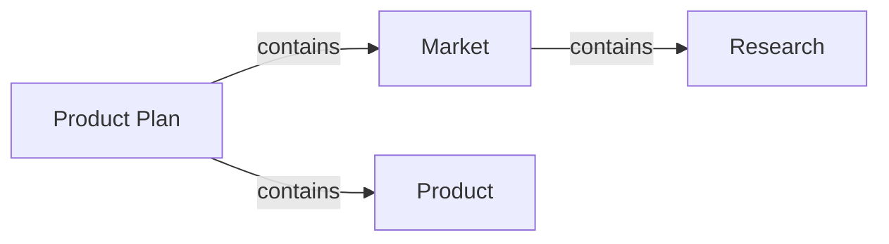
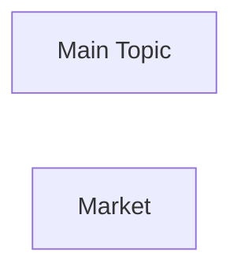
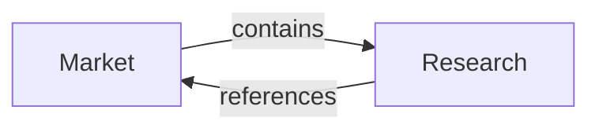
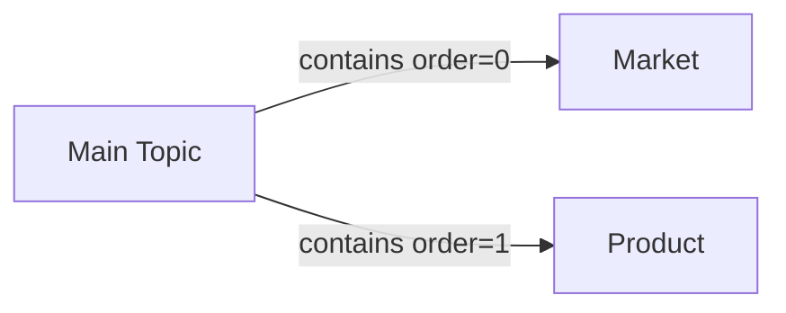
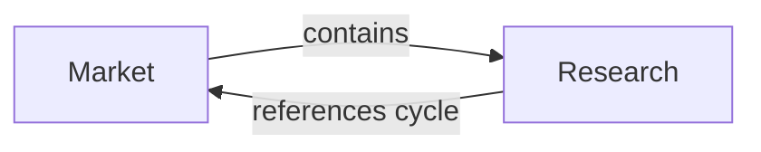

# Agent and Mermaid Contract

## Purpose

Mermaid should function as an LLM-facing projection format for structural understanding, not as the canonical stored format and not as the main UI render source.

The Mermaid Compiler is a standalone system mechanism. Tools and app workflows may request Mermaid output, but they should share the same compiler rules instead of formatting Mermaid independently.

This lets the system optimize for:

- Deterministic graph storage
- Compact context injection
- Readable structure for Codex
- Safer edit targeting

## Contract

The contract between the graph system, Mermaid projection, and agent-facing workflow should look like this:

1. Graph Query or Context Management reads canonical graph facts from Graph Core
2. Context Management resolves a user, tool, or agent-provided scope request into a focused scope, summary scope, or explicit projection
3. The selected graph facts are compiled through the Mermaid Compiler
4. Context Management provides Mermaid plus scope, version, omission, and edit constraints to the agent-facing workflow
5. The agent returns a typed graph operation batch or an ambiguity report
6. The Graph Edit Orchestrator previews, validates, and applies accepted operation batches through Graph Core
7. Mermaid and ReactFlow projections are recomputed from the updated canonical graph

## Why Mermaid Helps

Compared with raw application JSON, Mermaid gives the agent:

- Clear directed relationships in a short textual form
- Fewer irrelevant UI fields
- Lower prompt noise
- Better local reasoning over branches and siblings

Compared with ReactFlow state, Mermaid gives the agent:

- Structure without coordinate clutter
- Stable ordering
- No dependency on canvas state

## Constrained Mermaid Subset

The compiler should emit a limited and stable subset in v1:

- `flowchart LR` or `flowchart TD`
- Node declarations with stable ids
- Directed edges for graph relationships
- Escaped labels only
- Explicit relation labels when edge semantics matter
- Optional `projectionSupport` data for canonical ids when needed

Avoid in v1:

- Arbitrary styling syntax
- Free-form classes with semantic meaning
- Click handlers
- Complex subgraphs unless needed

Example:



## Mermaid Compilation Rules

The Mermaid Compiler should follow deterministic rules so the agent can map Mermaid text back to canonical graph facts without treating Mermaid as the source of truth.

### Node identifiers

Canonical `node.id` values are the real node identities. Mermaid node identifiers are projection identifiers derived from canonical ids.

Recommended v1 rules:

- Use a stable prefix such as `n_` for Mermaid node identifiers.
- Sanitize canonical ids into Mermaid-safe identifiers by replacing unsupported characters with `_`.
- Keep the mapping deterministic across repeated compilations.
- Use the node `title` as the default Mermaid label.
- Do not include `cardContent` or `notes` in the Mermaid node label unless the context request explicitly asks for richer node text.
- If sanitization can cause collisions, include a `projectionSupport` mapping from Mermaid node identifier to canonical `node.id`.

Example:



The agent should refer to canonical node ids in operation batches, not Mermaid-only identifiers.

### Edge identifiers, direction, and labels

Canonical `edge.id` values are the real edge identities. Mermaid edge syntax is only a projection of the canonical relationship.

Recommended v1 rules:

- Treat canonical edges as directed unless the data model later adds an explicit direction field.
- Render directed canonical edges with `-->`.
- If future schemas support undirected edges, render them with `---` and preserve the canonical direction mode in `projectionSupport`.
- Preserve `edge.kind` when it carries semantic meaning.
- Label edges with `kind` by default in agent-facing Mermaid, even when the visual renderer might omit that label.
- Keep canonical `edge.id` available in `projectionSupport` when the context may be used for edit targeting.

Example:



The agent should use canonical edge ids when updating or removing existing edges.

### Parent-child and sibling order

The canonical graph does not store visual left, right, up, or down relationships. It stores semantic relationships.

Recommended v1 rules:

- Treat `kind: "contains"` as the default parent-child relationship for mind-map style projections.
- Infer sibling groups from edges with the same `source` and relation `kind`.
- Sort siblings by `order` when `order` is present.
- Use deterministic fallback sorting, such as canonical edge id or target node id, when `order` is missing.
- Do not encode sibling order through Mermaid layout direction or visual position.
- When sibling order matters for editing, expose the relevant `order` values through context text or `projectionSupport`.

Example:



The `order=...` label is optional for display, but the ordering must be available to the agent when it is expected to insert, move, or reorder siblings.

### Cycle and repeated-node markers

Canonical graph data may contain cycles. Mermaid projections should be bounded and should not recursively expand the same node forever.

Recommended v1 rules:

- Use traversal-local visited state while compiling focused projections.
- Emit each canonical node once as a normal Mermaid node within a projection when practical.
- When traversal reaches an already-visited node, emit the relationship edge but do not expand that node again.
- Mark the revisited relationship as `cycle` when it points back to a node already in the current traversal path.
- Mark it as `repeated` when it points to a node already emitted elsewhere but not currently in the traversal path.
- Preserve the canonical target node id so the agent understands this is an existing node, not a duplicated node.

Example:



Cycle and repeated markers are projection facts. They must not be written back into canonical graph JSON.

### Projection Support Data

Mermaid should stay readable. When Mermaid syntax cannot safely carry all information needed for edit targeting, the context may include a small `projectionSupport` object.

`projectionSupport` should include only information needed to interpret the Mermaid projection, such as:

- Mermaid node identifier to canonical node id mapping
- Mermaid edge line or projection edge identifier to canonical edge id mapping
- `kind`, `order`, and direction information when not fully represented in Mermaid labels
- Cycle or repeated-node marker data
- Scope boundaries and omitted-content notices
- Facts derived from canonical graph data or projection traversal state only

`projectionSupport` should not include:

- Full canonical document JSON
- ReactFlow component state
- View positions, viewport, selection, or collapsed state
- File paths or storage configuration
- Prompt text or Codex host configuration

Example:

```json
{
  "projectionSupport": {
    "nodes": {
      "n_market": { "nodeId": "market" },
      "n_research": { "nodeId": "research" }
    },
    "edges": {
      "p_edge_research_market": {
        "edgeId": "edge_research_market",
        "source": "research",
        "target": "market",
        "kind": "references",
        "marker": "cycle"
      }
    }
  }
}
```

`projectionSupport` is an interpretation aid, not a mutation format. It is not the same as canonical node or edge `meta` fields.

## Edge Semantics

Mermaid output must preserve the relationship information needed for agent reasoning.

Recommended v1 rules:

- `contains` edges should be rendered as directed structural edges.
- Non-tree relations such as `references` should be visibly labeled.
- `order` should be reflected through deterministic edge ordering, not through layout coordinates.
- Canonical edge ids should remain available in `projectionSupport` when the result will be used for edit targeting or review.
- Mermaid text should not become the only place where edge semantics are stored.

Example:


## Context Handoff Pattern

The app should not always provide the full graph. Context Management should provide the smallest sufficient scope:

- Whole-map summary mode
- Focused subtree mode
- Edit-target mode
- Review mode

Example context frame:

```text
You are editing a mind map stored in canonical JSON.
Below is the Mermaid projection of the selected graph scope.

Document:
- documentId: doc_001
- graphVersion: 7

Scope:
- Only modify nodes and edges included in the selected projection
- Preserve existing node ids when possible
- Do not change sibling order outside the selected projection
- Treat omitted nodes and cycle markers as existing graph content, not as absent content

Mermaid:
flowchart LR
  n_market["Market"]
  n_research["Research"]
  n_channels["Channels"]
  n_market -->|"contains order=0"| n_research
  n_market -->|"contains order=1"| n_channels
```

## Expected Agent Outputs

Do not accept uncontrolled whole-document rewrites in v1.

The preferred v1 output is a typed operation batch compatible with `docs/operation-schema.md`.

Accepted output types:

- Structured `GraphOperation` batch
- Ambiguity report when the requested edit cannot be safely targeted
- Explanation-only response when no mutation is requested

Avoid in v1:

- Scoped subtree replacement
- Free-form patch objects
- Raw Mermaid replacement
- Direct JSON merge payloads

Example operation list:

```json
{
  "documentId": "doc_001",
  "baseGraphVersion": 7,
  "operations": [
    {
      "type": "addNode",
      "node": {
        "id": "pricing",
        "title": "Pricing",
        "cardContent": "Pricing strategy and packaging options.",
        "notes": "",
        "meta": {}
      }
    },
    {
      "type": "addEdge",
      "edge": {
        "id": "edge_market_pricing",
        "source": "market",
        "target": "pricing",
        "kind": "contains",
        "order": 1,
        "meta": {}
      }
    }
  ]
}
```

## Failure Modes to Prevent

- Agent invents ids that collide
- Agent rewrites unrelated branches
- Agent changes UI-only state through Mermaid context
- Agent returns Mermaid that cannot be mapped safely back to JSON
- Agent treats cycle markers or repeated references as duplicated canonical nodes
- Agent treats omitted nodes or edges as nonexistent graph content
- Agent infers edge semantics from visual style alone instead of explicit relation data

## Practical Rule

Use Mermaid for comprehension and instruction. Use the Graph Edit Orchestrator and Graph Core for mutation authority.
