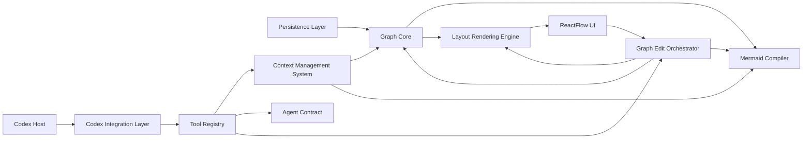

# Architecture

## Overview

The plugin is composed of core runtime modules and agent-facing support modules that communicate through explicit contracts rather than shared UI assumptions.



## Module Breakdown

### 1. Graph Core

Responsibilities:

- Define the canonical graph data schema
- Validate graph data integrity, including directed cycles where allowed
- Preserve node, edge, metadata, and `graphVersion` constraints
- Apply validated graph mutations without violating graph invariants
- Keep canonical graph data independent from rendering state, app config, and storage location details

Owned concerns:

- Node identity
- Directed edges and relationship semantics
- Semantic ordering where explicitly modeled
- Metadata
- `graphVersion` constraints

Must not depend on:

- ReactFlow components
- ReactFlow component state
- Mermaid parser internals
- File paths or workspace storage policy
- Codex app or plugin configuration
- Codex prompt wording

### 2. Mermaid Compiler

The Mermaid Compiler is an independent LLM-facing projection mechanism. It exists because screenshots and raw JSON are not reliable enough as the primary graph context for agents.

Responsibilities:

- Compile canonical graph data or extracted graph projections into stable Mermaid context
- Provide an LLM-readable structural view for agent reasoning
- Apply deterministic ordering, escaping, and cycle-marker rules
- Keep output scoped to the context requested by tools or the Context Management System
- Exclude view-state, ReactFlow data, storage metadata, and app configuration

Owned concerns:

- Graph-to-Mermaid transformation rules
- Mermaid-safe node and edge identifiers
- Label escaping and text normalization
- Deterministic node and edge ordering
- Representation of cycle and repeated-node markers already present in projections
- Stable Mermaid text formatting
- Respecting caller-provided output limits

Boundaries:

- Receives canonical graph data or extracted projections as input
- Does not own canonical graph state or persistence
- Does not perform graph traversal or choose extraction scope
- Does not render UI or manage ReactFlow view state
- Does not decide prompt framing or context injection policy

### 3. Layout Rendering Engine

The Layout Rendering Engine turns canonical graph JSON into an interactive mind map view. ReactFlow is the expected rendering library, but the engine owns the adapter, layout, measurement, semantic renderer mapping, and view-state concerns around it.

View-state details such as positions, dimensions, collapsed state, selection, focus, and viewport are documented separately in `docs/view-state.md`.

Theme and template mapping details such as layout defaults, renderer types, spacing, typography, colors, markers, and handles are documented separately in `docs/theme-template.md`.

Responsibilities:

- Convert canonical nodes and directed edges into ReactFlow-compatible view models
- Combine canonical graph data with separately stored view state such as positions, dimensions, collapsed nodes, viewport, and selection
- Generate initial node positions through a layout engine when view state has no usable coordinates
- Classify ReactFlow interactions as either graph edits or view-state edits
- Persist layout, dimension, viewport, selection, collapse, and appearance updates outside canonical graph JSON
- Resolve `diagramKind`, semantic node kinds, and semantic edge kinds into ReactFlow renderer types through a semantic renderer mapping
- Apply theme and template rules to choose node shapes, edge shapes, handles, markers, labels, spacing, and default appearance
- Measure rendered node dimensions from text content and feed those measurements back into view state
- Re-render the view after graph mutations, view-state changes, or layout recalculation

Owned concerns:

- ReactFlow node and edge view-model construction
- Position hydration from view state
- Initial and incremental layout calculation
- Layout engine integration, such as tree, layered, radial, or force-directed layout modes
- Node dimension estimation before render and DOM measurement after render
- Semantic renderer mapping from `diagramKind`, graph fields, and theme/template rules to ReactFlow node and edge types
- Renderer-specific node shapes, edge shapes, handles, markers, and labels
- Theme and appearance mapping from semantic graph fields to visual presentation
- View-state operations from dragging, resizing, collapsing, selecting, panning, zooming, and viewport changes
- Interaction classification for edits that should become canonical graph operations

Boundaries:

- Does not store canonical graph facts
- Does not decide graph semantics or relation meaning
- Does not decide `diagramKind`; it only reads and renders it
- Does not require canonical graph data to store ReactFlow renderer types
- Does not write ReactFlow component props into canonical graph JSON
- Does not treat layout movement as a graph relationship change unless the interaction is explicitly classified as a graph edit
- Does not own Mermaid generation or agent context formatting
- Does not own file paths, persistence policy, Codex app configuration, or prompt strategy

### 4. Codex Integration Layer

The Codex Integration Layer is a thin adapter between the Codex host application and the plugin internals. It isolates Codex-specific request and response details from the graph, rendering, context, and editing modules.

Responsibilities:

- Receive requests from Codex host workflows
- Normalize Codex-specific input into plugin action requests
- Route requests to the Tool Registry or other explicit plugin entrypoints
- Return structured results, previews, errors, and confirmation requests to Codex
- Keep Codex host APIs isolated from core plugin modules

Owned concerns:

- Codex request adaptation
- Codex response adaptation
- Host capability detection
- Plugin entrypoint routing

Boundaries:

- Does not define the full tool catalog
- Does not assemble graph context
- Does not compile Mermaid
- Does not write prompt contracts
- Does not apply graph edits directly
- Does not validate canonical graph invariants

### 5. Tool Registry

The Tool Registry is one part of the broader tool system that helps agents inspect, construct, reorganize, and safely edit mind map graphs. It defines the plugin's internal tools and keeps action names, schemas, permissions, and routing separate from both the Codex host adapter and the external MCP tool transport.

Responsibilities:

- Register internal tool and action names used by plugin workflows
- Define input schemas, result schemas, permission metadata, and confirmation requirements
- Route internal tool calls to Context Management System, Graph Edit Orchestrator, or graph query adapters
- Use Agent Contract schemas for agent-facing request and response envelopes
- Keep tool semantics stable independently from Codex-specific host APIs and MCP transport details

Owned concerns:

- Tool names and versions
- Tool input and output schemas
- Permission and confirmation metadata
- Tool-to-module routing

Boundaries:

- Does not construct prompts or decide model behavior
- Does not assemble context payloads directly
- Does not mutate canonical graph JSON directly
- Does not validate canonical graph invariants
- Does not implement Mermaid formatting rules
- Does not replace the external MCP server that exposes tools to Codex

### 6. Context Management System

The Context Management System prepares, budgets, injects, and remembers agent-facing context. It resolves user, tool, or agent-provided scope requests into bounded context, asks the appropriate graph query or projection mechanisms to produce that context, and returns structured context packets to agent-facing workflows.

This system may contain focused subcomponents such as a Context Builder, Context Budgeter, Context Packet Composer, Context Injection Adapter, Session Memory, and Long-term Memory. These subcomponents are implementation details; the architectural boundary is the full context lifecycle.

Responsibilities:

- Resolve user, tool, or agent-provided scope requests into bounded graph context
- Request graph projections such as subtrees, neighborhoods, paths, or summaries
- Call the Mermaid Compiler when Mermaid context is required
- Build structured context packets from graph queries, projections, summaries, Mermaid output, and memory entries
- Budget context size through priority, compression, truncation, and omission metadata
- Provide context payloads for Codex-facing injection or internal agent workflows
- Maintain session-scoped memory for ongoing agent workflows
- Optionally persist long-term memory such as user preferences, reusable graph-editing patterns, and cross-session context hints
- Link memory entries derived from graph data to document ids, `graphVersion` values, source nodes, or source edges
- Return structured context packets to tool or agent workflows

Owned concerns:

- Scope request resolution
- Context size budgeting
- Projection composition
- Context payload shape
- Context injection payload shape
- Session memory
- Long-term memory extension points
- Source references for context and memory entries

Boundaries:

- Does not own canonical graph truth
- Does not own Mermaid conversion rules
- Does not apply graph edits
- Does not validate edit operations
- Does not persist extracted projections
- Does not treat memory summaries as current graph facts without source validation
- Does not decide final prompt wording or model behavior
- Does not depend on ReactFlow component state

### 7. Agent Contract

The Agent Contract defines the structured input and output shapes used by agent-facing workflows. It is concerned with protocol shape, not with Codex host APIs or graph mutation authority.

Responsibilities:

- Define request envelopes for agent-assisted workflows
- Define response envelopes for explanations, previews, edit proposals, ambiguity reports, and failures
- Define structured edit proposal formats before they are sent to the Graph Edit Orchestrator
- Define how confirmation-required results are represented

Owned concerns:

- Agent-facing request schemas
- Agent-facing response schemas
- Structured edit proposal shape
- Error, ambiguity, and confirmation formats

Boundaries:

- Does not decide which tool should be called
- Does not assemble graph context
- Does not apply edit proposals
- Does not validate canonical graph invariants
- Does not store prompt wording inside canonical graph data

### 8. Graph Edit Orchestrator

The Graph Edit Orchestrator is the shared safety and transaction boundary for canonical graph changes. User edits and agent edits should use the same mutation pipeline and the same Graph Core invariants, while allowing different entry policies for trust, confirmation, and scope.

Responsibilities:

- Accept edit intents from both UI and agent workflows
- Translate intents into validated graph operations
- Enforce edit scope, graph version, and authorization rules
- Support preview, apply, reject, and undo hooks
- Apply actor-specific edit policies before canonical mutation
- Require confirmation for risky operations based on actor type, scope, and operation kind
- Ensure operation batches are atomic

Owned concerns:

- Intent normalization
- Conflict detection
- Preview diffs
- Transaction boundaries
- Actor-aware edit policy
- Confirmation requirements
- Operation batch atomicity

Shared constraints:

- Node ids must exist or be unique according to the operation type
- Edge sources and targets must exist
- Operation batches must carry and satisfy `graphVersion` checks
- Removing nodes must account for related edges
- `entryNodeId` must never point to a missing node
- Canonical graph mutations must not introduce ReactFlow view state or UI component data
- A batch should either apply completely or fail without partial canonical mutation

Actor policies:

- User edits may apply immediately for low-risk operations such as renaming, adding one node, or adding one edge
- User edits should still require confirmation for destructive or broad operations such as deleting a large branch
- Agent edits should default to preview-before-apply
- Agent edits should be scoped to the current selection, requested projection, or explicit user-approved scope
- Agent edits should be rejected when based on a stale `baseGraphVersion`
- Agent edits should not perform full-document rewrites
- System edits, such as migrations, should use explicit system actor metadata and should not be confused with user or agent intent

Recommended actor metadata:

- `actorType`: `user`, `agent`, or `system`
- `baseGraphVersion`: graph-content version used to produce the intent
- `scope`: selected nodes, selected edges, projection id, or explicit document-wide permission
- `riskLevel`: `low`, `medium`, or `high`
- `requiresConfirmation`: derived from actor type, operation kind, scope size, and destructive impact

Must not become:

- A rendering layer
- A storage abstraction
- A place for prompt text or UI component logic
- A replacement for Graph Core invariant validation

### 9. Persistence Layer

Responsibilities:

- Load and save document files
- Manage migrations
- Track `JSON-SchemaVersion` for data-structure migrations
- Track `graphVersion` for graph-content revisions
- Support snapshots or revision history later

Owned concerns:

- File shape
- File naming
- Backward compatibility

## Recommended Package Layout

This repository can stay simple at first, but should grow toward these module boundaries:

```text
mindMap/
  README.md
  docs/
  plugins/
    mind-map/
      .codex-plugin/
        plugin.json
      .mcp.json
      src/
        core/
        mermaid/
        layout/
        codex-integration/
        tools/
        context/
        agent-contract/
        editing/
        persistence/
```

If the codebase grows, the same boundaries can later be extracted into packages:

```text
packages/
  graph-core/
  mermaid-compiler/
  layout-rendering-engine/
  codex-integration/
  tool-registry/
  context-management/
  agent-contract/
  graph-edit-orchestrator/
  persistence/
apps/
  mind-map-plugin/
```

## Design Rules

1. Canonical graph data contains graph facts only.
2. All user and agent edits pass through the Graph Edit Orchestrator before canonical mutation.
3. Mermaid is generated on demand, not stored as the canonical document.
4. ReactFlow state is separately stored view state, not semantic truth.
5. Agent outputs should be structured edits or constrained patches, not blind full-document replacement.
6. File paths, Codex configuration, and component state must not enter the canonical graph document.
7. Codex-specific host behavior must stay inside the Codex Integration Layer.
8. Tool definitions, context management, and agent contracts must remain separate modules.

## Edit Flow Summary

The system should distinguish actor intent from mutation authority.

- Users act through direct UI gestures and form submissions
- Agents act through registered tools and structured agent contracts
- Both actors are normalized into the same operation model
- Canonical graph changes must satisfy Graph Core invariants

This split keeps editing logic testable and prevents UI gestures or LLM output formats from becoming implicit storage contracts.

## Recommended Interaction Boundary

- `ReactFlow UI` produces `UserIntent`
- `Codex Host` sends host-specific requests to `Codex Integration Layer`
- `Codex Integration Layer` normalizes requests into plugin action requests
- `Tool Registry` resolves action names, schemas, permissions, and module routing
- `Context Management System` assembles bounded graph context, requests Mermaid projections when needed, and manages agent-facing memory
- `Agent Contract` defines structured request and response envelopes for agent workflows
- `Graph Edit Orchestrator` converts user and agent edit intents into `GraphOperation[]`
- `Graph Core` validates canonical graph invariants while operations are applied
- `Persistence Layer` saves the next `graphVersion`
- `Mermaid Compiler` and `Layout Rendering Engine` regenerate agent and visual projections from the updated document

Tool-level capabilities are defined separately in `docs/tooling-contract.md`. Query tools such as `extract_subtree` should expose Graph Core traversal capabilities without persisting derived projections as document state.

## Key Risks

- Over-coupling Mermaid with ReactFlow layout requirements
- Letting prompt design leak into the graph model
- Treating drag-and-drop coordinates as semantic structure
- Allowing user edits and agent edits to bypass the same validation surface
- Using whole-document LLM rewrites instead of bounded subtree edits

## Suggested First Technical Milestone

Implement end-to-end flow without UI complexity:

1. Create a canonical graph document
2. Compile it to Mermaid
3. Produce ReactFlow nodes and edges
4. Round-trip a small structured edit back into the graph

If this flow is stable, the rest of the plugin can grow safely.
