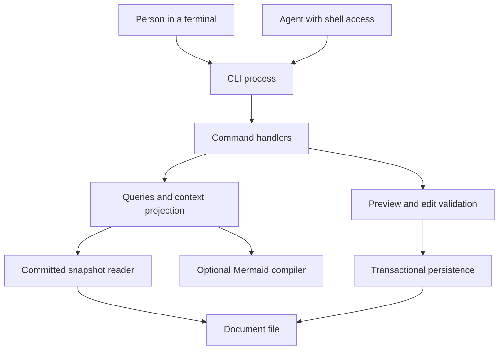

# Architecture

Status: target specification for CLI contract version 1. The first delivery is headless. See [acceptance](acceptance.md) for implementation evidence.

## Runtime boundaries

Every invocation is self-contained. No global current document, reader, selection, focus or task is stored. Several CLI processes may read the same file with different selectors. Ordinary commands exit after returning a result; no socket or daemon is needed.

## Modules

| Module | Owns | Must not own |
| --- | --- | --- |
| CLI adapter | Arguments, stdin/files, output format, exit status, help | Graph rules or direct writes |
| Command handlers | Typed request routing and result assembly | A second set of graph mutation rules |
| Graph core | Document types, graph validation, deterministic operations | Paths, locks, prompts, rendering components |
| Query/context | Explicit selectors, bounded traversal, field selection, omissions | Shared session state or edit authorization |
| Mermaid compiler | IDs, labels, relationship projection | Scope selection, graph writes or UI rendering |
| Edit validation | Write scope, final-state validation, structured diff | Long-lived agent locks or language-model reasoning |
| Persistence | Path identity, snapshot reads, commit locks, receipts, durable publication | Graph meaning or reader focus |

The package has one declarative command/schema definition. Argument parsing, `schema`, `capabilities`, help and validation derive from it. CLI reference examples are checked against that definition when implementation exists. Graph core and persistence remain callable internal libraries; they are not separately registered public tools.

## Data and authority

The [document](data-model.md) is the source of graph facts. Mermaid and context results are derived from one snapshot; they can be saved as reports but cannot be supplied as a replacement document to a mutation command.

People and agents have the same read capabilities and commit invariants. Optional actor labels provide attribution, not authentication or additional privileges. Operating-system file permissions remain the local access boundary. Scope limits are enforced on every direct and indirect change in an operation batch.

Read operations do not change graph versions or persist selected scope. A writer holds a lock only for the commit transaction, never while a reader reasons or prepares a batch. A preview is a prediction against a stated version, not a reservation.

## First-delivery storage boundary

Documents live at user-selected paths on a supported local filesystem. Package installation directories contain executable and reference assets only. No document data, lock or session state is stored in a package cache. The [persistence contract](persistence-and-concurrency.md) specifies per-document coordination and crash behavior.

This delivery supports cooperating local CLI processes. Remote synchronization, automatic merge, historical snapshot querying, network filesystems and arbitrary external file editors are outside its concurrency guarantee. A reader can save a returned result; a later read of the live file may observe a newer version.

## Deferred visual interface

A future browser editor can use an internal adapter to invoke the same command handlers and transaction code. It cannot introduce a competing write authority. UI lifecycle, independent window selections and refresh behavior are defined in [view state](view-state.md); layout choices are defined in [theme/template](theme-template.md).

The first release does not register or advertise UI commands or renderer availability. A graph's semantic type never implies that a corresponding visual layout exists.

## Required vertical slice

Capability discovery -> empty document creation -> independent scoped reads -> operation preview -> transactional apply -> reread and validation. This slice must work in separate terminal processes and from a packaged executable without a source checkout. Building a UI is not a prerequisite.
