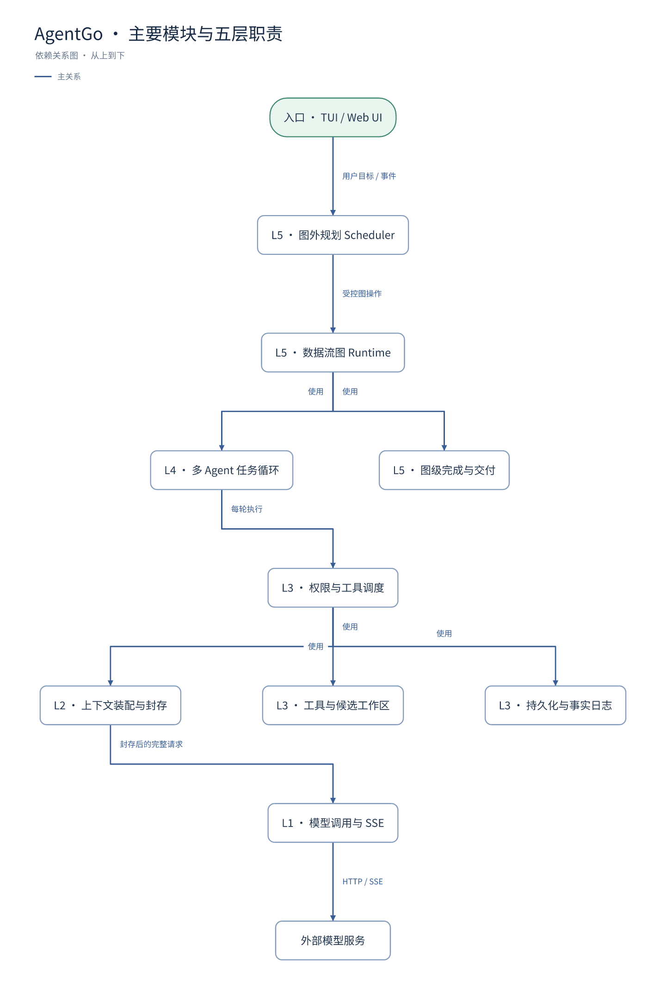
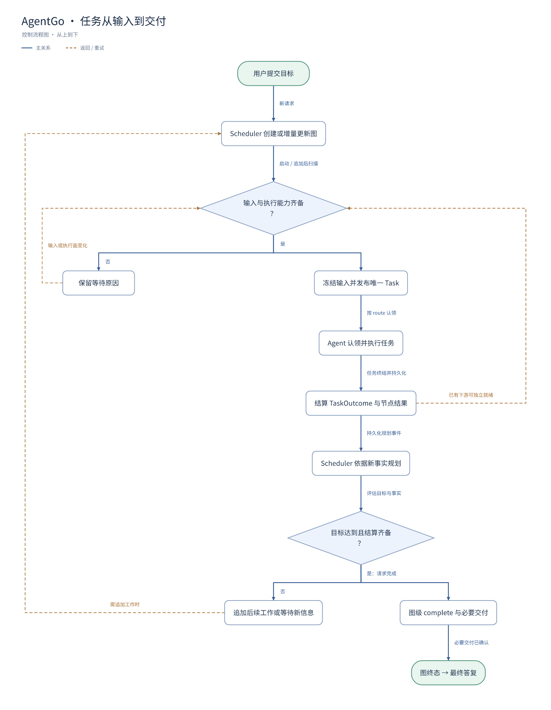

# AgentGo 架构图

核对日期：2026-09-19。源码仓库：`/Users/yanchenyu/Documents/ClawSeries/AgentGo`，提交 `84e7f83e4cf75f9e8db51bd1e5fac686c63e6274`。调查开始及结束时，AgentGo 只有原有的四个 `.DS_Store` 未跟踪文件；本次未修改 AgentGo 源码，也未启动 AgentGo 或调用模型服务。

依据当前 [五层规范](/Users/yanchenyu/Documents/ClawSeries/AgentGo/docs/design/five-layer-engineering-architecture.md)、[冻结契约](/Users/yanchenyu/Documents/ClawSeries/AgentGo/docs/design/contract-freeze-2026-08-30.md) 与对应源码绘制。图内节点的正文说明责任与边界，备注及 meta.sources 保留定位信息。

## 1. 主要模块与五层职责

[打开 SVG](architecture.svg) · [可编辑图文件](architecture.json) · [Mermaid 源码](architecture.mmd)



这是主干依赖/协作图，箭头按“发起方 → 被使用模块”阅读。它不是完整 Go import 图，也不是所有模块必须按顺序执行的时序图。相同层级标号表示责任域；画面高度不代表不同层号。为了减少交叉线，省略各模块到共享存储、输出观察面及执行结果返回的重复连线，相关事实放在节点正文和下图。

| 责任 | 核心作用 | 已核对的实现入口 |
|---|---|---|
| 入口及装配 | main、Bootstrap 装配依赖；TUI/Web 经 Hub 输入和观察 | [main.go:57](/Users/yanchenyu/Documents/ClawSeries/AgentGo/main.go:57)、[ui/control.go:35](/Users/yanchenyu/Documents/ClawSeries/AgentGo/internal/ui/control.go:35) |
| L5 Graph | 图外 Scheduler 规划；Runtime 冻结就绪输入、唯一派发、图级完成 | [Scheduler 指令与工具入口](/Users/yanchenyu/Documents/ClawSeries/AgentGo/internal/scheduler/scheduler.go:54)、[Step](/Users/yanchenyu/Documents/ClawSeries/AgentGo/internal/graph/dataflow_runtime.go:359) |
| L4 Loop | 认领 Task，管理 Attempt/Turn、重试、取消及唯一终态 | [认领与 processTask](/Users/yanchenyu/Documents/ClawSeries/AgentGo/internal/agent/agent.go:433)、[Runner 装配](/Users/yanchenyu/Documents/ClawSeries/AgentGo/internal/runner/runner.go:221) |
| L3 Harness | Lease、权限、工具路由、工作区、存储及副作用 | [工具 gate/dispatch](/Users/yanchenyu/Documents/ClawSeries/AgentGo/internal/agent/llm_executor.go:671)、[候选与工作区](/Users/yanchenyu/Documents/ClawSeries/AgentGo/internal/workspace/dataflow.go) |
| L2 Context | 原文上下文装配、快照封存、重放检查、输出订阅 | [Compile](/Users/yanchenyu/Documents/ClawSeries/AgentGo/internal/contextruntime/runtime.go:93)、[先存快照再调用](/Users/yanchenyu/Documents/ClawSeries/AgentGo/internal/contextruntime/runtime.go:160) |
| L1 Invocation | 完整请求校验、HTTP/SSE、归一化结果和失败 | [llm/request.go](/Users/yanchenyu/Documents/ClawSeries/AgentGo/internal/llm/request.go)、[SSE transport](/Users/yanchenyu/Documents/ClawSeries/AgentGo/internal/llm/sse_transport.go) |

Scheduler 自身也通过 Agent Loop 和 L3/L2/L1 执行；图中只画一次业务执行栈。`agent` 和 `runner` 是混合包，不能整个归入同一层。Bootstrap 负责装配；Trace 是跨层审计；UI 的模型输出来自 L2，均不是第六层。记忆的语义装配在 L2，落盘及恢复设施在 L3。

## 2. 任务从输入到交付

[打开 SVG](runtime.svg) · [可编辑图文件](runtime.json) · [Mermaid 源码](runtime.mmd)



这是系统运行过程的控制流程图，展示一条代表性任务路径和正常完成主线。不同就绪任务可并行执行，图中的每个框不是一类 AgentGo 业务节点。虚线表示运行时重新检查或再次规划，**不表示 Graph v7 业务图包含回边**。业务图每个 revision 是 DAG，迭代必须追加新的实例。

需要同时理解的两条路径：任务结果到达后，Runtime 可直接调度已有的就绪下游；另一方面，持久化图事件会交给图外 Scheduler 规划后续。下游不必等 Scheduler 再批准一次。[实现：pump](/Users/yanchenyu/Documents/ClawSeries/AgentGo/internal/bootstrap/dataflow_runtime.go:167)、[plan](/Users/yanchenyu/Documents/ClawSeries/AgentGo/internal/bootstrap/dataflow_runtime.go:234)。

图级完成由 `complete` 校验全部节点结算、选定结果与失败处置，再冻结完成意图。存在代码候选时，必须确认实际交付回执。纯文本结果不必产生文件提交。交付 unknown、基线冲突、取消和最终 failed/blocked 是明确的非成功路径；本图未展开这些故障处理子流程。[完成校验](/Users/yanchenyu/Documents/ClawSeries/AgentGo/internal/graph/dataflow_terminal.go:126)、[交付及终态](/Users/yanchenyu/Documents/ClawSeries/AgentGo/internal/graph/dataflow_terminal.go:231)。

## 当前版本与旧资料的区别

- 当前 L1 是 Model Invocation，不沿用旧“L1 Prompt”归类。
- `agentgo.graph/v7` 只接受 `agentTask`，依赖通过 `inputs` 声明。controller/router/join/acceptance/end、root/next/when 等旧结构已退役。[校验代码](/Users/yanchenyu/Documents/ClawSeries/AgentGo/internal/graph/dataflow_contract.go:116)
- 当前 Context 策略是 `context:default/v12`，原文装配；不画旧 Observation 模型控制链。
- 业务复核是普通任务，不是特殊控制节点；不可变候选与图级 Delivery 分开。
- 多文件交付不宣称 OS 原子事务，Effect unknown 不自动重放。
- 历史 Session 恢复上下文不等于自动续跑；SWE Python 判题是系统之外的独立事实。

## 编辑、引用与复用

在 MindMap 仓库根目录运行：

```sh
node bin/mindmap.js ui examples/agentgo-architecture/architecture.json
node bin/mindmap.js ui examples/agentgo-architecture/runtime.json
```

图上点击节点即可编辑正文和备注；Shift 多选后可复制给 Agent。详细上下文也可通过 CLI 独立读取：

```sh
node bin/mindmap.js context examples/agentgo-architecture/architecture.json --nodes graph,scheduler,delivery --content all --max-text-bytes 0 --json
```

JSON 是可编辑的源图。SVG、PNG、Mermaid 是本次版本的导出快照，之后编辑 JSON 不会自动更新这些静态文件。`.operations.json` 与 `.refine.operations.json` 保留本次原始提交字节，不能把旧版本批次直接当成新的修改重放。

## 验证边界

两图均经过 CLI create → preview → apply → validate；再进行完整 context 读取、SVG 渲染、PNG 光栅化与实际画面检查。核对节点/边保留、布局无警告和源码定位有效。此次结论是当前源码与规范的结构调查，不是新一轮 AgentGo 二进制运行测试，也不引用旧 SWE 成绩冒充本次验证。
