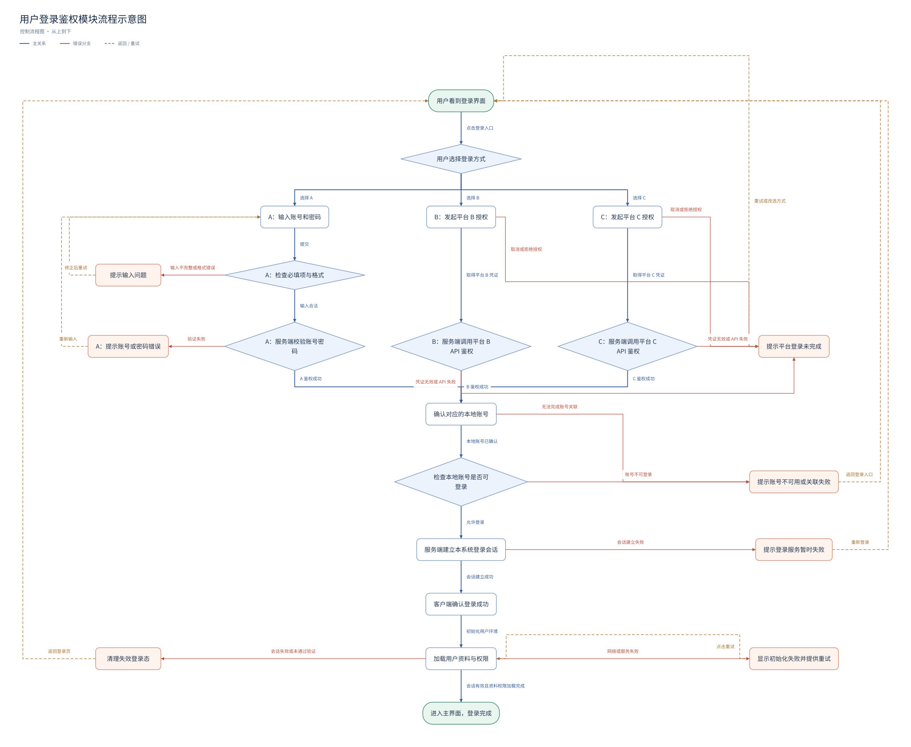

# 用户登录鉴权模块流程示意图

由 MindMap CLI 实际生成。图版本 2，22 个节点、34 条边。

A 使用本系统账号密码；B、C 分别走对应平台 API 鉴权。三条路径从同一执行层分开，在账号确认节点汇合，再建立会话、加载资料与权限并进入主界面。错误分支置于侧边，重试使用单独走线。首次平台登录的本地账号创建或绑定规则由业务策略决定。

[横向 SVG](flowchart-lr.svg) · [PNG 预览](flowchart.png) · [规范图数据](document.json) · [布局坐标](layout.json) · [Mermaid 原文](diagram.mmd) · [含布局提示的 Mermaid](diagram-with-layout.mmd)

SVG 固定保留本程序的排版。外部 Mermaid 查看器可能忽略布局提示。
