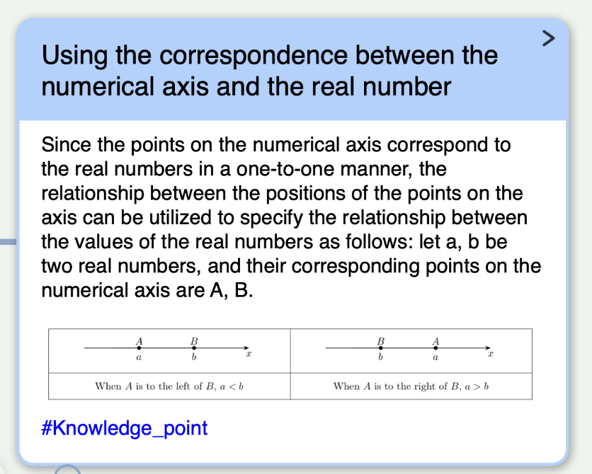

# 外观设计草案

更新日期：2026-10-15。

本文件属于[四部分架构](architecture.md)中的外观部分，分别记录产品设计与技术草案。A1–A4 的首版产品规则已确定，S6 明确首版仅使用默认主题；具体样式参数与运行接入仍需验证。外观参考稿不作为完整导图运行能力或尺寸定稿的证明。

## 产品设计草案

### 已确认的方向与参考

默认外观以**简洁、清楚、便于阅读**为方向，延续用户提出的飞书文档／画板体验参考，以用户提供的卡片截图作为具体视觉依据。参考方向不构成完整复刻其功能、图类型或业务语义的要求。

参考图的主要特征是浅蓝标题区、白色正文、同色边框、圆角和轻阴影。默认圆角矩形卡片以这些特征为视觉基准，标题与正文形成清楚的层次；右上角入口沿用已经确定的圆形展开按钮。字体、颜色、间距与尺寸的精确值属于后续技术参数，不逐项要求用户确认。

参考中的正文图片和蓝色文字不构成新的标签、知识点分类或专用内容能力。当前内容仍限于既定 Markdown 与公式，图片、表格只使用 Markdown 语法。

### 已确定的启动形态与工具栏

这一轮先准备最基础的节点外观素材。“四边形”已由用户明确为平行四边形；此前已确认的圆形继续保留，不额外引入任意四边形绘制能力。

| 启动形态 | 轮廓 | 内容与含义 |
| --- | --- | --- |
| 圆角矩形 | 四边为水平／垂直边，四角采用圆角 | 默认卡片的视觉基准；使用参考图的简洁层次 |
| 直角矩形 | 四角为直角 | 与圆角矩形共用内容组织，只改变轮廓 |
| 菱形 | 上、右、下、左四个顶点形成菱形 | 文字保持正向阅读，不自动表示判断或条件 |
| 平行四边形 | 上下边平行，左右边沿同一方向倾斜 | 文字保持正向阅读，不自动表示输入、输出或其他业务角色 |
| 圆形 | 圆形轮廓 | 延续此前确认的形态，不自动表示开始、结束或参与者 |

这些是同一种节点的不同外观，可以自由混用与切换，标题、卡片文本、笔记及有向边规则一致。圆角矩形与直角矩形是两个明确的形状选项，不用颜色区分。

**工具栏形状按钮按节点编辑焦点分发。** 有节点编辑焦点时，点击形状只把该节点改成所选形态；无节点编辑焦点时，才创建一个采用该形态的新节点。一次点击不同时新增和换形，也不要求选择业务类型；批量选集不触发批量换形。该 S4 决定替代早期“形状按钮总是新增”的设定。

实际新增时共用既定默认标题“新节点”、聚焦、候选位置与局部避让规则；形状按钮的无节点焦点分支创建独立节点，有节点焦点的换形分支保留原 ID、内容和已有边。通用新增操作已有的自动连线规则保留，默认贝塞尔，但换形不调用该操作。用户手动创建边须先选工具栏线工具，再依次选端点。图标与名称由外观提供，入口组织由外壳负责，不把工具栏素材扩展成模板或预制子图。

### A1 已确定的节点阅读区域

**收起时保留所选形状，展开后一律显示为统一的圆角矩形阅读卡片。** 展开只切换当前展示，不修改节点保存的收起形状；五种启动形态共用同一档固定展开尺寸与内容布局。

| 收起形状 | 收起时的内部安排 |
| --- | --- |
| 圆角矩形、直角矩形 | 标题在上、卡片文本在下，沿用参考图的分区；只有轮廓圆角不同 |
| 菱形 | 中心安排水平矩形阅读区，标题在上、卡片文本在下，四个尖角留白 |
| 平行四边形 | 左右斜边预留空间，内部阅读区保持水平，不使文本、图片和表格倾斜 |
| 圆形 | 圆内安排居中的矩形阅读区，避开上下两端收窄的位置，标题在上、卡片文本在下 |

所有收起形态隐藏笔记与标题图片。标题和卡片文本超出阅读区域时可滚动查看，不为适应轮廓而缩小到难以阅读、永久裁掉正文或仅展示摘要。展开按钮在各形状的右上侧保持可操作，不压住正文。

展开后一律采用参考图的圆角矩形布局：

- 顶部固定标题区采用默认浅蓝背景；标题过长时在自身区域滚动。
- 下方从上到下显示卡片文本、笔记，两者共用正文滚动区域，卡片文本不冻结。
- 笔记前用轻分隔线与“笔记”标识区分；笔记为空时，预览不显示空白分区。展开并进入编辑时仍提供笔记输入入口，允许从空笔记开始编辑。
- 右上角保留圆形收起按钮，位置稳定。
- 标题栏靠右、收起按钮旁显示“收起形状的小轮廓图标＋名称”，例如菱形图标与“菱形”。这是只读识别提示，不是另一个操作按钮，也不是卡片内容截图。

收起形状标识表示节点当前保存／编辑的形状，不固定为创建时的初始形状。用户在展开状态下主动切换形态时，修改收起形状并同步更新标识；展开外框仍保持圆角矩形，收起后显示新选形状。

展开与收起始终操作同一个节点，不创建副本、占位节点或另一个弹出窗口；ID、完整内容、属性与关系保持不变。以当前位置为基础变更显示外框，必要时按 L4 局部避让，连线贴合当前可见轮廓。保存保留收起形状与最终坐标，不保存展开状态；重新打开或刷新后回到各自的收起形状。

### 已确定的渲染技术边界

**采用 HTML 节点内容与 SVG 连线配合的方案，允许运行时使用 SVG；拖动节点时，关联连线必须实时跟随。** 节点轮廓、箭头、图标、KaTeX 的局部公式符号及正常图片资源也允许使用 SVG，不再设置统一的格式禁令。

标题、正文、笔记、输入控件、按钮和边说明编辑使用普通 HTML 内容，CSS 提供外观；连线使用可更新的 SVG 路径。节点轮廓按形态选择 CSS 或 SVG 表达，文字与编辑区保持正向且可访问。默认连线为贝塞尔曲线，用户也可以创建直角折线或直线；三者均使用 SVG 路径，业务关系模型不变。

用户持续拖动节点时，连线端点与路径在拖动过程中更新，不能等松开鼠标后才重绘。实时跟随同样涵盖批量移动、必要的邻居避让和视野跟随；节点与连线使用一致的几何状态与画布变换。

渲染结果不是新的源文本。节点、正文、边和坐标仍按既有 HTML 格式保存；运行时 SVG 路径、KaTeX 预览及图形组件内部状态不作为权威数据回写。原有 Markdown、LaTeX、手动保存和操作规则继续适用。

### 延续已有产品规则

| 项目 | 已确定的边界 |
| --- | --- |
| 节点形态 | 圆角矩形、直角矩形、菱形、平行四边形和圆形可混用和切换；形态只影响外观，完整内容与边保持不变 |
| 收起卡片 | 显示标题文字与卡片内容，隐藏笔记和标题图片；长内容允许滚动访问，不永久裁去或替换成摘要 |
| 展开卡片 | 五种形态均显示为统一固定尺寸的圆角矩形，标识当前收起形状；标题区固定置顶，正文与笔记滚动，不随笔记长度无限增高 |
| 展开入口 | 右上方圆形按钮，或既定的长按 1 秒；外观不改变焦点、长按与点击的逻辑 |
| 编辑与预览 | 节点有编辑焦点时显示纯文本源码，失焦后预览；编辑与预览共用固定展开外框。边说明只在双击进入编辑后显示 |
| 内容边界 | 所有形态都能访问标题、卡片内容、笔记；不因轮廓变化删除 Markdown 图片或表格 |
| 不叠放 | 节点不能相互叠放；尺寸变化交由逻辑测量与局部避让，不以层级覆盖解决 |
| 有向边 | 箭头方向必须可辨识，连线说明为纯文本；支持既定选中、编辑与端点改接，不提供手动折点调整 |
| 画布与状态 | 开启后的自动适配、缩放、查找定位和焦点跟随沿用 L7；外观只呈现当前状态 |

### A2 已确定的连线与说明

| 编号 | 已确定的产品内容 |
| --- | --- |
| A2.1 路径形态 | 默认创建贝塞尔曲线，同时允许用户创建直角折线或直线；创建时选择外观，不恢复业务关系类别，也不增加手动折点编辑 |
| A2.2 绕行与交叉 | 贝塞尔曲线与直角折线自动绕开无关节点；直线保持笔直，允许被节点遮挡，节点绘制在直线上方。相交的不同连线使用不同颜色区分，交叉处不产生连接 |
| A2.3 说明文本框 | 说明框属于对应边，不是独立节点；仅在双击进入说明编辑后显示。显示时其几何中心位于所属连线路径上，默认位于路径中部；通常避让其他可见说明框和所有节点卡片；直线空间不足时按下述遮挡例外处理 |
| A2.4 全文显示 | 显示中的说明框完整显示合法文本，内容增长时扩张，即便尺寸很大也不截成摘要、折叠或省略；既有纯文本和 1024 码点上限保持不变 |

说明框中心可以沿所属路径自动调整来避让，不能默认偏移到线外；框内文字保持水平是技术初值，不随曲线倾斜。文字框背景可遮住其覆盖区域内的线条，以保持可读性；“中心在线上”指几何路径约束，不要求线条穿过文字。非编辑状态不显示说明框，即使说明非空；空说明的边也能双击打开输入框。退出编辑后接纳有效文字并隐藏说明框，不保留常驻预览。

节点覆盖直线不属于“节点互相叠放”，不会改变 L4 的禁止节点叠放规则。可见说明框通常避开节点与其他可见说明框；直线说明框空间不足时可以被节点遮挡。边与边则可以交叉并通过颜色区分。单击边只选中，双击才显示说明框并编辑；框内操作始终属于同一条边，Delete 仍删除整条边。不增加手动拖动说明位置的能力。

#### 直线说明框的遮挡例外

当直线路径上的空间不足，无法同时满足全文排版、中心在线上和避让要求时，**直线说明框的优先级最低，允许被节点压住**。它仍属于原边，保持中心在直线上并按完整合法文本扩张；被节点遮挡的文字不删除、不截断、不替换成摘要。

这一例外只放宽节点对直线说明框的遮挡，不放宽节点之间禁止叠放，也不把其他说明框之间的重叠视为允许。一般情况下说明框仍正常避让；不把直线例外扩展为曲线或直角折线说明框的通用遮挡规则。

**当前暂不解决这一极端情况。** 不为此增加自动搬动节点、改变直线路径形态、将说明框移到线外并补引线、置顶说明框或新的人工恢复入口，也不增加用户可调整的层级字段。此项不再作为待讨论问题或本期必须完成的几何求解任务。

自环、平行边的特殊路径，以及颜色、线宽、箭头尺寸、说明框初始排版宽度和命中容差由开发方补齐并验证；不承诺所有极端说明框布局均有完全避让的解。说明框显示时机与焦点外观按下述 A3 执行。

### A3 已确定的交互状态

**统一使用粗描边表示焦点外观，默认背景下为蓝色。** 节点编辑焦点、批量节点选中、边选中及当前查找定位对象复用这一外观，不另设不同的高亮配色。外观由逻辑维护的状态驱动，不改变各状态的操作含义。

| 状态或操作 | 已确定的显示规则 |
| --- | --- |
| 节点编辑焦点 | 沿节点当前可见轮廓显示粗描边；节点文字按既定规则进入源码编辑，获得焦点不自动展开笔记 |
| 框选节点 | 鼠标拖出选框，仅节点可被框选，边不可被框选；全部选中节点显示相同焦点描边。仍只进行 L3 的批量移动、删除和复制，不同时进入多个节点的文字编辑 |
| 单击选中边 | 加粗描边表示选中，可直接 Delete 删除整条边；说明框继续隐藏 |
| 双击编辑边 | 保持同一条边的焦点描边，显示其说明输入框；退出说明编辑后隐藏。未选中或仅选中而未编辑时都不显示说明框 |
| 查找定位 | 只突出当前定位的对象，不同时突出全部命中对象；复用焦点描边，但不自动选中、进入文字编辑、展开卡片或显示边说明框 |
| 鼠标悬停 | 没有悬停反馈，不增加悬停高亮、浮动提示或临时显现的说明框 |
| 操作进行中 | 不增加过程提示、候选目标高亮或避让闪烁；保留实际操作结果，节点移动时连线仍实时跟随 |

统一的是视觉样式：单对象编辑焦点、批量节点选集和当前查找定位仍分别维护，查找标记不会成为 Delete 的删除目标。框选矩形和已选边的端点控制点是既有操作控件，不额外附加过程提示；右上方警告栏既定的源文件错误警告继续保留。

说明框隐藏只影响展示，完整说明仍参与保存、限长与查找；不以文本是否可见来判断边是否有效。A2 的全文扩张、中心在线上与避让规则作用于正在显示的说明框，隐藏框不占用避让空间。当前只允许编辑一条边，不为避让规则新增多个同时开启的说明编辑框。

### A4 已确定的整体画布

| 编号 | 议题 | 已确定的产品内容 |
| --- | --- | --- |
| A4.1 | 画布背景 | 默认界面使用浅色点阵，点的颜色为浅灰；点阵只是视觉背景，不附带吸附、对齐或坐标取整行为 |
| A4.2 | 缩放显示 | 缩小时，画布内所有元素使用同一个比例等比缩小，包括节点、文字、图片、公式、连线、箭头、说明框、焦点描边与节点／边上的操作控件；不保证最小可辨识尺寸，不对其中某类元素单独放大或保持固定屏幕尺寸 |
| A4.3 | 周边工具配色 | 首版统一使用默认主题，工具栏、查找工具、警告栏采用白色底、黑色边框；不提供主题选择或切换入口 |

画布缩放不改变既定内容可见性：不因缩小而隐藏正文、替换成摘要、自动收起卡片或改变边说明的显示条件。小比例下内容可以难以辨认，用户自行放大查看；初始适配仍以看见全部节点为目标，焦点跟随仍只负责让操作区域处于视野内，不另行放大到可读尺寸。

这项缩放规则作用于图画布中的内容；工具栏、查找工具与警告栏属于外壳界面，配色随主题。S3 已确定左侧竖向工具栏常驻不可收起，右上方横向警告栏常驻，下方查找框按需打开并可关闭；三个区域浮置于画布。点阵的精确色值、点径、间距与画布底色由技术草案提供初值，不逐项作为产品待定问题。

### 外壳 S3 的工具区域外观参考

[左侧工具栏参考截图](assets/toolbar-left-reference.png)只用于确定工具条外形：左侧留边、竖向窄条、圆角容器、轻阴影、单列图标按钮和细分隔线，作为浮层覆盖局部画布。默认仍使用 A4 的白底黑边，主题配色统一管理；截图中部内容、顶部界面和额外工具功能不纳入设计。

左侧工具栏始终显示，不可关闭或收起；新建图、打开其他图、保存始终位于最上方，下方安排形状与线工具。撤销、复制、删除只提供快捷键，不配置按钮。位置与画布遮挡的处理见[外壳工具栏设计](shell.md#s3-已确定的左侧工具栏)，工具栏不随图平移缩放，也不新增悬停反馈。

[查找与警告区域参考截图](assets/search-warning-reference.png)中的下方横向圆角查找框用于本项目，上方原状态条的位置改为警告栏；两者位于右上方、右侧对齐、上下留出间距，浮置在画布上。警告栏常驻，无警告时显示空状态；查找框按需打开，含输入区、结果计数和右侧关闭按钮。查找关闭不影响警告栏，不复刻分享、编辑模式、评论等功能，也不加入截图中的额外匹配选项，节点／边筛选保持。具体规则见[外壳查找与警告布局](shell.md#s3-已确定的查找与警告布局)。

两个横向容器沿用白底黑边的默认主题，可使用圆角和轻阴影；宽高、间距与多条警告的滚动布局由技术草案确定，不逐像素复制截图。右上横向警告栏替代旧文档中的纵向警告侧栏，不保留两套并行的警告区域。

S4 在右上角与警告栏同区提供缩放滑块、当前比例、回到原点与打开查找的入口，警告内容仍保持可见。查找框使用上／下箭头按钮分别定位上一个／下一个结果，不提供点击结果列表定位；按钮名称可识别，沿用无悬停反馈规则，不引入加减缩放或恢复 100% 控件。

### 产品设计清单状态

A1–A4 已按当前决定记录，没有剩余的 A 编号产品问题。直线说明框空间不足时沿用已定遮挡例外，极端求解继续暂缓。尺寸、色值、线宽和技术接入仍需实现与验证，不把产品规则确定等同于功能已经完成。

默认主题覆盖画布、节点、连线及外壳工具，样式与必要资源按 S1 作为本地版本化公共资源交付；[外壳 S6](shell.md#s6-仅使用默认主题)已明确首版不提供主题选择或切换入口。五种节点形状与三种线型继续保留，不属于多主题功能；既有样式引用保持。本轮不新增自定义样式编辑器、分区、边界或模板。

## 技术草案

### 职责与接入边界

| 部分 | 与外观的配合 |
| --- | --- |
| 源文本 | 保存节点的收起形态、样式引用、内容与坐标，不保存展开外框、形状标识或其他预览状态 |
| 外观 | 定义颜色、字体、间距、形态、外框尺寸、内部阅读区域和状态表现 |
| 逻辑 | 维护焦点等状态，测量节点、投影连线连接点、局部避让、处理视野跟随与保存 |
| 外壳 | 组织工具栏、查找、警告等界面，加载样式与运行资源，提供可用画布范围 |

外观不执行布局算法或文件读写。需要运行逻辑的交互仍由 TypeScript 处理；CSS 根据逻辑给出的状态呈现，不建立另一份可修改文档模型。

### HTML 节点与 SVG 连线的接入方向

| 内容 | 实现方向 | 技术边界 |
| --- | --- | --- |
| 节点与编辑控件 | 普通 HTML 元素，CSS 定义阅读区域 | 保留真实文本、按钮与输入控件；不将整张卡片转换成图片 |
| 节点轮廓 | 按形态使用 CSS 或独立 SVG 轮廓 | 轮廓与文字分开，绘制与边缘连接使用一致的几何定义 |
| 直线、折线与曲线 | 由 TS 按所选外观计算路径，默认贝塞尔；曲线与直角折线绕开无关节点 | 直线允许被节点覆盖；路径、交叉颜色和说明框随几何变化同步更新，不等拖拽结束 |
| 边说明 | 双击编辑时挂载普通 HTML 输入框，自动扩张并沿路径定位 | 非编辑时隐藏且不占避让空间；显示时全文排版、中心在线上，通常避让其他可见说明框与节点；保留直线遮挡例外，不创建独立图节点 |
| 工具栏图标与操作控件 | CSS、SVG 或正常图像资源 | 可以使用输出 SVG 的图标组件，仍需满足入口识别与可访问性，不另加悬停或操作过程提示 |
| 公式预览 | 沿用 `rehype-katex`／KaTeX | 保留内联与块级 LaTeX；允许 HTML 排版中的局部 SVG 符号 |

React Flow 可继续作为渲染与交互候选，其自定义节点与 SVG 连线路径可用于承载上述方向；最近边缘连接、局部避让、业务删除和撤销仍按本项目规则接入。[官方连线说明](https://reactflow.dev/learn/customization/custom-edges) 本稿不锁定依赖版本，不为规避 SVG 额外引入 Canvas 或 Konva。

节点移动时更新卡片位置与受影响的连线路径，无需反复生成整份 HTML 或重新创建所有 SVG 元素。公式内容、字体和排版条件不变时，已有 KaTeX 结果随卡片容器移动，不在每个拖拽帧重新排版公式。

默认主题 CSS 统一提供画布、HTML 内容、SVG 连线和外壳工具的配色，工具栏、查找工具与警告栏采用白底黑边。公共样式更新影响实际尺寸或轮廓时，逻辑重新测量、更新连接点并执行必要避让；纯配色变化不改变节点坐标。这是样式更新的技术约束，不新增运行时主题切换能力。样式、必要字体与图标随固定版本本地公共资源交付，图 HTML 通过相对路径加载，不内嵌这些运行资源。

### 样式引用与参数

沿用源文本已有的 `class` 引用：`map` 等结构类名保持稳定；`round-rect`、`rect`、`diamond`、`parallelogram`、`circle` 选择要保存的收起形态；`default` 引用首版唯一默认主题，`basic` 引用其基础节点样式，不表示第二套主题。具体 CSS 参数继续通过技术验证调整，样式表限定作用范围，避免节点 Markdown、输入控件与外壳界面相互覆盖。

颜色、字级、行距、边框、圆角、阴影、内容留白及收起／展开尺寸集中管理。参数具体如何命名和组织由开发方补齐，源文本不重复保存整套 CSS 参数。状态样式不反向写入源文本。

上一轮外观对照稿使用了以下候选值，保留作技术试验起点，**不是已确认的产品尺寸**：

| 参数 | 对照稿值 | 状态 |
| --- | --- | --- |
| 标题与边框主色 | `#B4D1FB` | 来自参考图主色采样，最终样式仍需验证对比与状态区分 |
| 圆角矩形收起外框 | `360 × 300` | 候选值，不作为其他形态或所有内容的既定尺寸 |
| 固定展开外框 | `520 × 460` | 统一圆角矩形已确定，具体宽高仍是待验证的技术初值 |
| 圆角、边框、内容横向留白 | `14`、`2`、`16` | 对照稿初值，可随视觉方案调整 |

尺寸按画布缩放为 1 时的 CSS 像素尺度解释。截图像素不直接等同于真实网页的 CSS 像素；窄会话窗口中的演示缩放也不构成运行时自动改变节点宽度的产品规则。

### 点阵、统一缩放与主题工具的技术接入

点阵由外观绘制为画布背景，不生成图节点、关系或可选对象，也不进入碰撞、搜索和源文本。采用图坐标中的重复图案，点径与点距使用同一画布比例，图案原点与画布平移同步。初始技术值为：底色 `#FAFAFA`、点色 `#D9D9D9`、点半径 1、点距 24，尺寸同样按缩放为 1 时解释；这些是待视觉验证的初值，不改变浅灰点阵的产品方向。

节点内容层、SVG 路径层、边说明层、焦点轮廓与附属于图对象的控件共同使用一个缩放比例。尺寸为 `d` 的图内元素在比例 `s` 下显示为 `s × d`；不为线宽、箭头、文字或控件设置屏幕尺寸下限，也不采用反向缩放补偿。点阵同样随图缩放，不通过保持点距或点径的屏幕尺寸例外放大。工具栏、查找工具和警告栏留在外壳界面，不加入图坐标的缩放变换。

A1、A2 中可读字号和全文排版要求针对元素自身的内部排版，不能为适应形状或避让而删字、缩小正文；它们不构成对用户画布缩放的最小字号要求。纯缩放只改变显示变换，不能将屏幕缩小后的测量结果当作新的图内尺寸，不能因此改写节点坐标、触发内容重排或生成局部避让位移。初始适配与焦点跟随沿用 L7，不为了可读性擅自提高用户选择的比例。

外壳工具共用主题的工具区域底色与边框色定义，默认分别为 `#FFFFFF` 和 `#000000`；边框粗细、文字与图标色由对应主题样式统一管理。节点的浅蓝标题、白色正文、焦点蓝描边及 A2 交叉边异色规则继续保留，不因外壳黑边而改成统一黑色。主题引用仍沿用已有样式引用，点阵与各工具的具体配色不逐项写入图文件，也不增加每个工具的独立主题字段。

### 几何与内容区域

收起形态共用字体、配色、边框与内容区域的基础参数；收起时圆角参数只作用于 `round-rect`，`rect` 保持直角。展开时所有形态明确使用统一圆角矩形外框，不把这一展示状态覆盖到持久化形态中。菱形和平行四边形的外轮廓变换不能连带旋转或倾斜文本、图片、表格、滚动条与按钮。

每种形态需给逻辑提供一致的可见轮廓与测量结果，用于现有边缘连接、命中和局部避让。碰撞继续按逻辑草案采用实际外框的轴对齐包围矩形；阴影与选择描边不改变文档坐标或制造新的层级字段。

几何外框与阅读区域分别处理。收起时按上述 A1 方案为菱形、平行四边形和圆形计算可用的矩形阅读区，不能简单旋转或裁切整张卡片；展开时共同使用一个圆角矩形阅读结构。具体留白和尺寸由样式参数与测量验证，不要求用户决定内接区域的计算公式。

标题、正文与笔记沿用现有区域规则。固定展开外框不随源码／预览切换或笔记长度改变；标题自身过长可在标题区滚动，正文与笔记共用其下方滚动区域。图片和表格的内容适配只影响内部阅读，不改写 Markdown 源码。

样式加载、形态切换或资源变化可能改变实测外框。逻辑完成测量、局部避让与必要的视野跟随后再提交可见画面；外观不通过动态调整层级掩盖冲突，也不自行推导节点关系。

### 收起形态与展开状态的技术接入

源文本现有的形态类名就是唯一持久化形态；展开标志只在页面状态中维护。显示轮廓由两者派生：收起使用该形态，展开使用圆角矩形。渲染可以使用独立状态类或属性，但保存从有效模型读取形态，不能从当前可见外框反推 `round-rect`，也不新增第二份“原始形状”字段。

形状标识从现有形态映射到轮廓图标与名称，不保存缩略图、不生成内容截图。标识、“笔记”标签和分隔线都属于界面，不写进三个文本字段，不参与字数限制或正文搜索。标题文本的滚动区域与标识、收起按钮分开，避免长标题把控件挤走。

预览时空笔记省略其展示分区，但源文本的空 `div.notes` 继续保留；编辑展开节点时保留可访问的笔记输入控件。收起和展开复用同一节点内容模型与输入草稿，不能因为切换阅读结构丢失未保存文本。

连线投影和碰撞测量读取派生后的可见轮廓：收起贴原形态边缘，展开贴圆角矩形边缘。归一化连接位置、节点 ID 与边关系仍保留，不为展示变形反复改写源数据。单独展开／收起改变可见几何时沿用局部避让及用户操作整体撤销；展开期间修改收起形状而可见外框未变时，只更新形态记录和标识，不人为制造位移或重建边。

### 连线路径、交叉配色与说明框的技术接入

连线外观与关系语义分开。源文本记录用户创建时所选的贝塞尔、直角折线或直线外观，具体路径、交叉配色、说明框尺寸与自动位置是派生显示。曲线可由多段贝塞尔路径组成，折线由水平／垂直线段组成；不把自动绕行控制点暴露为手动编辑功能。

曲线和折线依据当前实际节点外框规划绕行，不能穿越无关卡片；直线直接连接两端，由节点覆盖被遮挡段，不为保持直线而擅自移动节点。起终点仍使用已定边缘连接位置，拖动、展开或避让后实时更新。说明框空间不足时按已定直线遮挡例外处理，不额外改变节点坐标或直线形态。

对相交的不同边建立配色约束，交叉的两条边不能同色。颜色取自主题可辨识色组，优先保留已有可用分配，以稳定 ID 或源顺序处理冲突，避免无关操作导致整图换色；需要时扩充可辨颜色，不能在冲突位置默默复用同色。配色不代表流程、依赖等业务类型，也不新增源文本类型字段。

说明框仅在该边的说明编辑状态开启时参与渲染和测量，默认位于当前路径的弧长中点，不能简单取两端坐标平均值来代替。避让时优先保留当前合法位置，否则沿所属路径搜索靠近中部的可行位置；每个候选位置均以文本框几何中心落在路径上为约束，检查整个外框与其他可见说明框、全部节点的相交情况。隐藏说明不产生占用区域；当前单边编辑意味着通常只有一个可见说明框。不能只比较中心点距离或仅避开文字像素。直线无法获得完全避让位置时，保留沿线路径上的说明框，并由节点覆盖相交部分；不为这一情况继续扩展几何求解功能。

采用正常可读字号与水平文本排版，保留换行、允许长词换行；以样式初始宽度排版并按内容自动增高或扩宽，不设导致正文裁切的固定最大高度、行数或内部滚动区域。可见输入控件随完整文本调整尺寸，既定输入限长规则继续执行；非编辑状态不另生成说明预览。超过视窗时通过画布浏览及焦点跟随访问，不把视窗尺寸当作删字或截断显示的依据。

说明框通过所属边 ID 读取文本，点击与双击转交同一边的交互流程。文字框背景、边线和颜色是外观，不写入说明文字。文字修改、主题字号变化或连线路径变化后重新测量并联动避让，路径与文字框使用同一版本的几何状态；直线说明框的节点遮挡只作为既定展示例外，不删除有效说明或将其转为格式错误。绘制优先级由内部样式统一处理，不写入源文本，也不提供置顶／置底功能。

### 状态与边的呈现

逻辑分别维护单对象焦点、批量节点 ID 集合、当前查找定位 ID 与边说明编辑状态。外观从前三者派生是否应用同一套焦点描边；只有边说明编辑状态决定说明框是否显示，不能用通用的“有焦点”标志同时打开所有正文编辑器或边说明框。查找标记不写入选集或对象焦点，不参与 Delete 分发；新的定位替换旧查找标记，清空查找、删除目标或刷新时移除对应标记。

焦点颜色与描边宽度使用统一样式参数，默认背景采用蓝色。节点使用独立轮廓层或 outline，边在原有路径下方加绘较粗的蓝色外描边并保留原路径颜色，使 A2 的交叉异色仍可辨认；两层归属同一个边 ID，不能形成重复选中目标。描边不改变节点占用范围、连接点或文档坐标，不触发局部避让。

边说明输入框在双击进入编辑后挂载或显示；先从有效文本初始化，空说明也提供输入入口。退出编辑先接纳合法文本，再卸载或隐藏并清除其占用测量；不能从隐藏 DOM 反推说明为空。框内切换光标或选择文字仍属于同一个边，不重复收尾。非编辑状态的单击、悬停与查找均不能显示该框。

不启用组件附带的悬停变色、浮动提示、候选节点高亮、拖拽残影或避让闪烁。框选矩形、选中边的端点控件、文本输入光标与实际几何更新保留；它们不另派生一套过程提示状态。节点和边的临时状态类只用于运行时渲染，保存仍从有效源模型序列化，不写出焦点、选集或查找标记。

连线的方向、端点和说明由源文本与逻辑决定，外观只规定视觉。路径计算、实际命中容差及端点改接仍归逻辑；A2 按贝塞尔默认、绕行、编辑中全文说明框与直线遮挡例外落实，不在外观草案中恢复手动折点功能。

### 后续验证

- 对照参考图检查标题层次、留白、边框与阴影是否保持简洁；对照稿的轻量交互验证不代替完整应用验收。
- 验证五种收起形态都在水平阅读区提供标题和卡片文本；展开都变成同一固定圆角矩形，标题固定、卡片内容与笔记滚动，收起时恢复所选形态。
- 验证展开时切换收起形状会更新标识但不改变展开外框；保存再打开仍是所选收起形状，不能全部被写成 `round-rect`。
- 验证空笔记在预览中不占空白分区，进入展开编辑后仍能新增笔记；形状标识不混入正文、搜索或字符计数。
- 在上述状态下验证长标题、正文、笔记、Markdown 图片、表格和公式均可访问。
- 在拖动尚未结束的多个中间位置检查节点和关联连线同步更新；覆盖自环、平行边、批量移动、邻居避让及画布平移缩放，不能仅检查松开鼠标后的画面。
- 验证默认贝塞尔及可创建的直角折线、直线；曲线与折线绕开无关节点，直线可被节点遮挡，所有边的关系与端点不因绕行改变。
- 验证交叉边异色，焦点外描边不覆盖原有区分色；进入边说明编辑后，框默认居于弧长中点，避让后中心仍在线上，常规场景避开节点与其他可见说明框，合法长说明全文排版且框随内容扩张。
- 验证单击边只有焦点描边且可 Delete 删除，双击才显示说明输入框；退出编辑后隐藏，正文仍可保存和查找，隐藏框不参与避让；空说明同样可双击输入。
- 验证框选仅命中节点，所有选中节点统一粗描边且不同时编辑文字；框内边不进入选集，批量移动、删除和复制仍按 L3 处理关联边。
- 验证查找仅突出当前定位对象，切换结果清除旧标记，不改变编辑焦点、展开状态或边说明可见性；所有焦点外观不引起节点尺寸、坐标或边连接点变化。
- 验证鼠标悬停无反馈、操作中无额外提示；实际拖动、框选、端点控制和实时连线仍可用。
- 验证默认画布为浅灰点阵，点阵随画布平移缩放，不参与选中、查找、碰撞或保存，也不触发网格吸附。
- 比较同一场景在不同缩放比例下的尺寸：节点、内容、连线、箭头、说明框、焦点描边与图内控件均等比变化，没有最低屏幕尺寸补偿；纯缩放不改写坐标、不触发避让或自动隐藏正文，也不自动放大焦点对象。
- 验证默认工具栏、查找工具和警告栏均为白底黑边，与节点及画布共用默认主题；没有主题选择或切换入口，五种节点形状和三种线型仍可使用。外壳工具不随图画布缩放。
- 验证直线空间不足时节点可以遮住其说明框，源文字仍完整保留，中心仍在线上；不移动节点、不改变直线、不增加离线引线或置顶入口。极端布局的完整求解不作为本期验收条件。
- 检查 KaTeX 根号、长箭头等含局部 SVG 的公式显示正常；移动卡片时公式随容器移动，不因拖动反复重新排版或丢失内容。
- 验证形状工具有节点焦点时只换形、无节点焦点时新增；新增默认内容和位置规则一致，换形保留 ID、内容和已有边，目标在收尾时被删除则不补建节点。入口图标与所选形态一致。
- 验证文件三按钮始终位于左栏最上方；无撤销、复制、删除按钮；右上滑块、比例、回原点和查找入口与警告栏同区，查找仅用上／下箭头逐项定位。
- 对照左侧工具栏参考检查竖向窄条、单列图标、圆角与轻阴影；默认白底黑边、常驻且不可收起，浮置于画布且不随图平移缩放；截图中的额外图标不扩展产品范围。
- 对照第二张参考检查右上警告栏与下方查找框的位置：警告栏始终显示、无警告为空状态，查找按需打开且关闭后能重开；关闭不影响其他工具，不复刻原状态条功能或增加匹配筛选。
- 验证编辑／预览切换、圆形展开按钮、内部滚动与既定焦点行为配合，不因样式变化产生额外删除或编辑动作。
- 验证轮廓、连接点、测量、局部避让和视野跟随一致；缩放与样式调整不污染源文本。
- 在实际目标宿主中验证字体、样式与资源加载；功能完成后再按既定 10–200 个节点范围分析性能。

[外壳设计草案](shell.md)已建立：S1–S4 明确公共资源、文件操作、工具区域布局和入口分发；S5 暂不展开，S6 仅使用默认主题。首版产品设计基线已齐备；运行实现、具体依赖版本与宿主验证均未由本稿完成。
