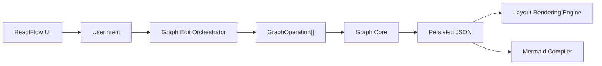
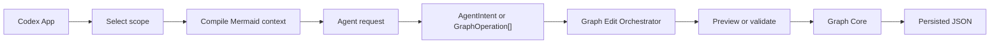

# Editing Architecture

## Purpose

This document defines how users and agents edit the same mind map without creating separate mutation systems.

The central rule is:

- Users and agents may express different kinds of intent
- The system must reduce both into one validated operation pipeline

This avoids three common failures:

- UI logic silently mutating canonical state
- Agents bypassing validation with whole-document rewrites
- Divergence between visual edits and semantic edits

## Actors

There are two first-class editing actors.

### User

The user edits the map through direct interactions:

- Typing node text
- Creating child or sibling nodes
- Dragging nodes on the canvas
- Reparenting a branch
- Reordering siblings
- Collapsing or expanding subtrees

### Agent

The agent edits the map through semantic requests:

- Expand this branch into three subtopics
- Reorganize this subtree by theme
- Convert these notes into a branch hierarchy
- Merge duplicate branches
- Rename nodes for consistency

The agent should not directly manipulate ReactFlow state by default.

## Edit Layers

The editing system should be modeled as four layers.

### 1. Intent Layer

This is where actor-specific requests appear.

Examples:

- `UserIntent.DragNode`
- `UserIntent.SubmitRename`
- `AgentIntent.ExpandSubtree`
- `AgentIntent.RestructureBranch`

This layer is actor-facing and may vary by UI or prompt design.

### 2. Operation Layer

This is the shared mutation contract.

Examples:

- `addNode`
- `updateNode`
- `moveNode`
- `reorderChildren`
- `setNodePosition`
- `toggleCollapse`

The operation layer must be deterministic, serializable, and validation-friendly.

### 3. Canonical Graph Layer

This is the only mutation authority.

Rules:

- Only canonical JSON is persisted
- Only Graph Core applies operations
- Every applied operation must preserve graph invariants

### 4. Projection Layer

This is where the document becomes consumer-specific output:

- ReactFlow view model for UI
- Mermaid projection for agent context

Projections must never become write authorities on their own.

## User Editing Flow

User editing should follow this path:

Examples:

- Dragging a node on the canvas emits `setNodePosition`
- Dropping a node onto another node with a semantic reparent action emits `moveNode`
- Clicking "add child" emits `addNode`

The UI must distinguish visual drag from structural reparenting. These gestures may look similar but have different persistence meaning.

## Agent Editing Flow

Agent editing should follow this path:

The recommended default is:

- Inject Mermaid for comprehension
- Include scoped node content fields when text editing is requested
- Request structured operations as output
- Validate scope before apply
- Show preview before commit

## Authority Boundaries

### What users may change

By default, users may change:

- Structure
- Layout
- Collapse state
- Node text
- Node ordering

### What agents may change

By default, agents may change:

- Structure within an allowed scope
- Node text
- Ordering within an allowed scope
- Semantic metadata

Agents should not change by default:

- Absolute layout positions
- Viewport state
- Selection state
- Arbitrary UI-only styling

## Graph Edit Orchestrator Responsibilities

The Graph Edit Orchestrator exists to keep graph editing rules, safety checks, and transaction boundaries in one place.

It should handle:

- Intent normalization
- Operation batching
- Scope restriction
- Version checks
- Preview diffs
- Rejection of invalid or stale edits
- Actor-aware edit policies
- Confirmation requirements for risky edits
- Atomic apply-or-reject behavior
- Undo integration later

It should not:

- Store canonical data itself
- Render the map
- Contain domain logic already owned by Graph Core

User edits and agent edits should share the same underlying Graph Core invariants. The difference is policy, not graph validity.

Shared constraints:

- Node and edge references must be valid
- Operation batches must satisfy `baseGraphVersion`
- Destructive operations must account for affected nodes and edges
- Canonical graph updates must not contain view state or ReactFlow component data
- A batch should not partially mutate canonical graph state

Actor-specific policies:

- User low-risk edits may apply immediately
- User broad or destructive edits should require confirmation
- Agent edits should default to preview-before-apply
- Agent edits should be restricted to the selected or explicitly approved scope
- Agent edits based on stale graph context should be rejected
- Agent edits should never use whole-document JSON replacement

## Agent Workflow Edit Lock

MVP should use a document-level canonical edit lock while an agent workflow is active.

The lock exists because the agent reasons over a specific `graphVersion`. If the user changes canonical graph structure or node content while the agent is analyzing context or preparing operations, the agent's proposed batch may no longer match the current graph.

Recommended v1 rules:

- Acquire the edit lock when an agent workflow starts with graph context.
- Record the `graphVersion` used to build the agent context.
- Block user actions that mutate canonical graph data while the lock is active.
- Allow non-mutating view actions such as pan, zoom, and inspection.
- Treat selection changes cautiously; they should not change the active agent scope unless the workflow explicitly supports scope updates.
- Release the lock when the workflow is applied, rejected, cancelled, or fails.
- Reject the agent batch if `baseGraphVersion` still does not match the current graph when applying.

This document-level lock is intentionally conservative. Future versions may replace it with scope-level locks, queued user edits, conflict previews, or merge policies.

## Graph Versioning and Concurrency

The first implementation should use graph-content version checks, not real-time collaboration primitives.

Recommended rule:

- Every operation batch carries `baseGraphVersion`
- If the current `metadata.graphVersion` does not match, reject and recompute

This is enough for v1 and keeps agent edits from overwriting recent user work silently.

## Preview Strategy

Agent edits should default to preview-before-apply.

Suggested preview forms:

- Tree diff by affected branch
- Operation list summary
- Mermaid before and after for the scoped subtree

User edits usually do not need an explicit preview because the UI interaction itself already acts as preview.

## Practical Rule

Users and agents may edit differently, but they must never mutate differently.
