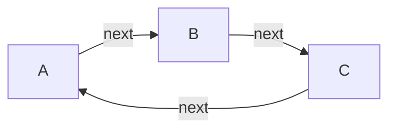

# Mermaid Projection

Status: target optional context format for the headless CLI. This document owns structural projection rules, not query scope or mutation rules.

## Input and output

The compiler receives returned internal nodes and edges from one [context result](context-management.md). It never reopens the file. It emits `flowchart LR` by default or `flowchart TD` when requested. This is structural text output available to both people and agents, not a promise of a visual layout engine.

Context `data.mermaid` is:

- `text`: deterministic Mermaid source.
- `nodeIds`: map from projection ID to canonical node ID.
- `edgeIds`: array of `{index, edgeId, source, target, kind, order}` in emitted edge order; optional stored order is represented as null when absent. Index is zero-based.

Without `--mermaid`, this field is null. The context result already carries content, scope, version, boundaries and omissions; the compiler does not create a second competing context envelope.

## Stable identifiers and labels

Sort canonical node IDs by locale-independent code-point order, then assign projection identifiers `n_0`, `n_1`, and so on. Projection IDs are stable for the same returned node set, not persistent identities across different scopes. Mutation payloads always use canonical IDs from the mapping.

Emit quoted rectangular labels from the returned node titles. Escape labels using Mermaid numeric entity notation for unsafe characters: encode `&`, `"`, `#`, `<`, `>`, `[`, `]`, `{`, `}`, `|`, backslash and backtick as `#<decimal Unicode code point>;`; replace CR, LF and tab with a space before encoding. Preserve ordinary Unicode. Decimal references follow the [official Mermaid flowchart entity syntax](https://github.com/mermaid-js/mermaid/blob/develop/docs/syntax/flowchart.md#entity-codes-to-escape-characters). Emit no click handlers, classes, arbitrary styles, subgraphs or executable content. Test generated text with a parser/rendering fixture before declaring this format supported; a string snapshot alone does not prove valid syntax.

## Relationship preservation

Sort internal edges by canonical ID and emit every returned edge once with an arrow and quoted kind label. If order exists, append ` order=<integer>` to the label before escaping. Self-loops, parallel edges and closing cycle edges remain edges; they are not duplicated canonical nodes or removed to produce a tree.

Traversal is bounded in query/context code. Finite traversal and acyclic graph structure are different concepts. No acyclicity guarantee is made for this output. Boundary edges with missing outside-node content remain in the structured context and are not drawn by inventing nodes.

For a context containing a cycle, valid structural output includes:

## Authority

Titles can be truncated by query limits; omission markers still apply to Mermaid labels. Source graph facts and full values must be reread when an edit needs omitted content. Mermaid source is never accepted by apply as a whole-document replacement. Agent workflow instructions live in the [skill](../skills/mindmap-cli/SKILL.md); operation formats live in [operation schema](operation-schema.md).
